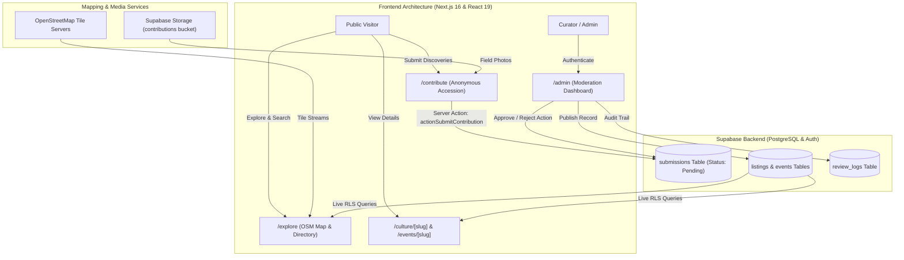
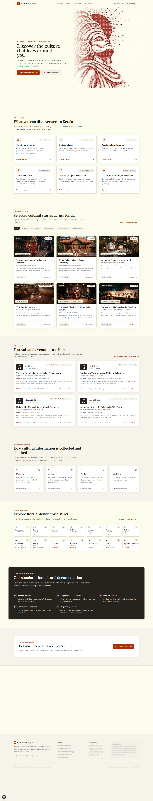
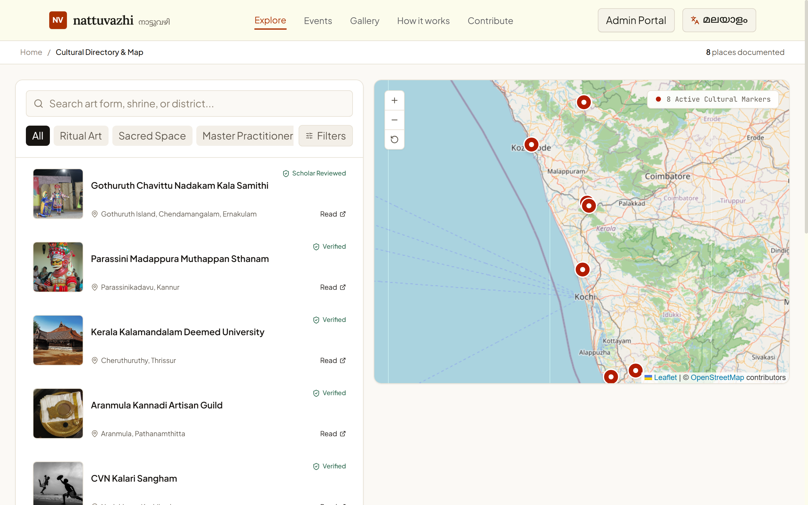
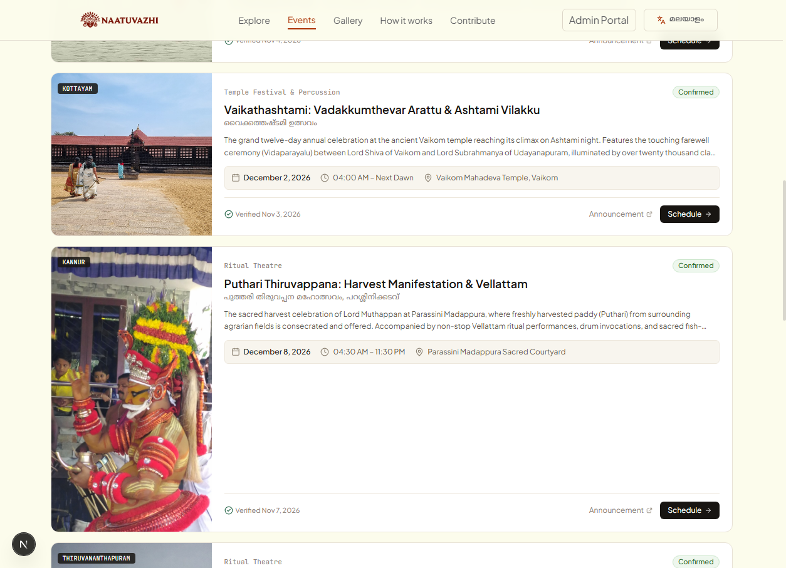
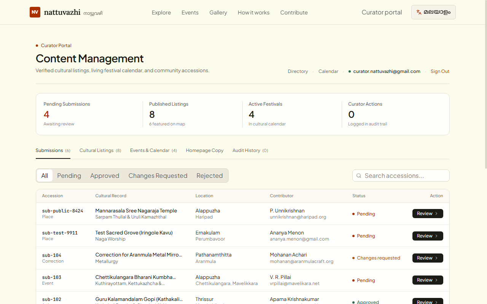

# Nattuvazhi (നാട്ടുവഴി) — The Living Culture Map of Kerala

> **ART//CODE — Track 5: The Living Culture Map**  
> A community-informed, scholar-verified cultural cartography and living spatial archive for Kerala's intangible heritage, sacred spaces, master practitioners, and traditional festivals.

---

## 1. Project Overview

**Nattuvazhi (നാട്ടുവഴി)** is a digital cartography and living spatial archive dedicated to safeguarding and celebrating Kerala's rich cultural landscape. From centuries-old sacred groves (*sarpa kavus*) and nocturnal ritual performances (*Theyyam*, *Tholpavakoothu*, *Patayani*) to hereditary master craft guilds (*Aranmula Kannadi*, *Balaramapuram Weaving*) and historic martial traditions (*Kalaripayattu*), Nattuvazhi maps tangible and intangible heritage with geographic precision.

The platform provides an authentic alternative to commercialized tourist guides. Every entry includes verified historical provenance, oral traditions, respectful visitor protocols, seasonal timings, and direct citations from authoritative ethnographic gazetteers and the Kerala Folklore Academy.

---

## 2. Problem Statement

Kerala possesses a millennia-old continuum of living traditions. However, cultural documentation and festival discoverability face several critical challenges:

1. **Fragmented Documentation**: Important oral traditions, temple rites, and master practitioners' histories remain trapped in disparate regional gazetteers, trust pamphlets, or memory.
2. **Commercial Distortions & Protocol Violations**: General travel itineraries often omit sacred visitor codes, leading to disrespectful tourism in delicate ritual sanctuums like *kavus* and *theyyam* shrines.
3. **Unpredictable Living Calendars**: Ritual festival calendars fluctuate according to Malayalam astronomical calculations (*Kollam Era*), making it difficult for researchers and cultural enthusiasts to obtain verified dates and schedules.
4. **Lack of Verified Crowdsourcing**: Local community members who preserve these arts lack a scholar-moderated platform to contribute local knowledge without the risk of spam or unverified commercial promotions.

Nattuvazhi solves this by establishing a decentralized, community-driven accession pipeline verified by cultural curators and scholars before publication on an interactive geographic map.

---

## 3. Key Features

- **Interactive OpenStreetMap Geographic Cartography**: A high-performance geographic engine built on OpenStreetMap and Leaflet, displaying live coordinate pins for sacred spaces, traditional institutions, and upcoming festivals across all 14 Kerala districts.
- **Bilingual Interface (English & Malayalam)**: Native Malayalam typography and English descriptions toggleable across the entire platform, honoring the linguistic identity of the land.
- **Living Cultural Festival Calendar**: Up-to-date schedule of authentic Kerala festivals, boat races, and rituals (e.g., Kalpathi Ratholsavam, Guruvayur Ekadasi, Cochin Carnival, Beemapally Uroos) with venue coordinates, event timings, and Devaswom links.
- **Detailed Cultural Dossiers & Visitor Protocols**: Each listing includes historical significance, audio/visual archives, verified source citations, and sensitive visitor codes (dress rules, photography restrictions, conduct guidelines).
- **Public Frictionless Submissions (No Account Required)**: Visitors can submit discoveries, upload field photographs directly to Supabase Storage, and contribute oral histories without logging in.
- **Curator Content Management Portal (`/admin`)**: A dedicated administration dashboard with Supabase Auth, moderation queues, real-time approval/rejection workflows, listing editors, and immutable audit logs.
- **Strict Privacy & Moderation**: Public contributions remain in a pending state until vetted by curators, ensuring that zero unverified or inappropriate content appears publicly.

---

## 4. Technology Stack

- **Frontend & App Framework**: Next.js 16 (React 19, Server Components, Server Actions, Dynamic Routing)
- **Cartography & Spatial Visualization**: OpenStreetMap (OSM) Tiles, Leaflet 1.9, React-Leaflet
- **Backend & Database**: Supabase PostgreSQL with custom relational schemas and Row Level Security (RLS)
- **File Storage**: Supabase Storage (`contributions` bucket with strict MIME validation)
- **Authentication**: Supabase Auth (curator login with session validation)
- **Styling & UI Design**: Tailwind CSS v4, Apple-inspired editorial design system (`#FCFBEF` warm parchment canvas, `#B21C01` Theyyam vermilion, `#181512` charcoal typography)
- **Icons & Visuals**: Lucide React, SVG vector graphics
- **Language & Runtime**: TypeScript 5, Node.js 20+

---

## 5. System Architecture



---

## 6. Installation & Setup Instructions

### Prerequisites
- Node.js 18.17+ or 20+ installed
- Git installed
- A Supabase account (or local Supabase CLI)

### 1. Clone Repository
```bash
git clone https://github.com/edwieee/naatuvazhi.git
cd naatuvazhi
```

### 2. Install Dependencies
```bash
npm install
```

### 3. Setup Environment Variables
Create a `.env.local` file in the root directory:
```bash
cp .env.example .env.local
```
Fill in your Supabase credentials (see [Section 7](#7-environment-variables)).

### 4. Database Setup
Execute the migration scripts located in `supabase/migrations/` inside your Supabase SQL Editor:
1. `supabase/migrations/20261108000000_nattuvazhi_core_schema.sql` (Creates tables, RLS policies, and triggers)
2. `supabase/migrations/20261108000001_seed_authentic_kerala_cultural_data.sql` (Inserts authentic cultural listings and districts)

### 5. Run Development Server
```bash
npm run dev
```
Open [http://localhost:3000](http://localhost:3000) in your browser.

### 6. Run Production Build
```bash
npm run build
npm run start
```

---

## 7. Environment Variables

Create `.env.local` with the following variables:

| Variable Name | Required | Description |
|---|---|---|
| `NEXT_PUBLIC_SUPABASE_URL` | Yes | Supabase Project URL (`https://<project-ref>.supabase.co`) |
| `NEXT_PUBLIC_SUPABASE_PUBLISHABLE_KEY` | Yes | Supabase Anonymous / Publishable Key |
| `SUPABASE_SERVICE_ROLE_KEY` | Optional | Supabase Service Role Key (used only for backend administrative tasks) |

Example `.env.local`:
```env
NEXT_PUBLIC_SUPABASE_URL=https://ccmdiokhunvhwdmvsvop.supabase.co
NEXT_PUBLIC_SUPABASE_PUBLISHABLE_KEY=sb_publishable_wSv5bY6NkHCrveOBJLqsVw_cmNHtnEw
```

> **Security Note:** Never commit `.env.local` to Git. It is automatically excluded via `.gitignore`.

---

## 8. Usage Instructions

### 1. Exploring Cultural Listings & Geographic Map (`/explore`)
- Navigate to **Explore** in the header.
- Filter by cultural category (*Sacred Space*, *Master Practitioner*, *Traditional Craft*, *Cultural Institution*, *Ritual Art*, *Martial Tradition*) or select any of Kerala's 14 districts.
- Click any map pin to inspect the popup preview and click **Explore Story & Protocol** to navigate to the full dossier.
- Map and listing cards remain synchronized: selecting a card pans the map to the respective coordinates.

### 2. Viewing Festivals & Calendar (`/events`)
- Navigate to **Events** in the navigation bar.
- Switch between **Upcoming Festivals** and **Past Archives**.
- Search by festival title, temple venue, or art form (e.g., *Ilanjithara Melam*, *Uroos*, *Vallamkali*).
- Click any festival to view detailed schedules, traditional organizers, and official Devaswom links.

### 3. Submitting a Cultural Discovery (`/contribute`)
- Click **Contribute** in the top navigation (no account or login required).
- Select contribution type: *Cultural Place / Shrine*, *Artist / Practitioner*, *Guild / Institution*, *Living Event / Festival*, or *Factual Correction*.
- Fill in the verified details, upload field photographs (automatically stored in Supabase Storage), provide coordinates if known, and enter your contact email.
- Click **Submit discovery for review** to receive an accession tracking ID.

### 4. Curator Moderation Portal (`/admin`)
- Access `/admin/login` and sign in using authorized curator credentials (demo credentials available on the page for evaluation).
- Review submissions in the **Submissions Queue** (`/admin/review/[id]`).
- Approve submissions to instantly publish them to the live `/explore` directory or `/events` calendar, request revisions with curator notes, or reject unverified entries.

---

## 9. Demonstration Screenshots

### Desktop Homepage & Halftone Canvas


### OpenStreetMap Interactive Cultural GIS Explorer


### Living Festivals & Cultural Calendar


### Curator Moderation & Content Management Dashboard


---

## 10. Team Members

- **Edwin Biju** — Full Stack Engineering, Spatial Cartography & Editorial UI/UX Design  
  *GitHub*: [@edwieee](https://github.com/edwieee) | *Email*: [edwinbiju135@gmail.com](mailto:edwinbiju135@gmail.com)

---

## 11. Limitations & Future Scope

### Current Limitations
- **Offline Map Caching**: Full map tiles require an active internet connection; deep forest *kavus* with zero cellular reception cannot cache tiles without prior pre-caching.
- **Audio Streaming**: Oral histories and musical recitations are presently documented via archival citations rather than in-browser high-resolution streaming.
- **Dynamic Astronomical Calendar Calculations**: Complex Malayalam Panchangam dates are manually curated and confirmed via Devaswom releases rather than calculated algorithmically.

### Future Scope
- **Audio Soundscapes of Kerala**: Embedded field recordings of traditional acoustic instruments (*Chenda*, *Kuzhal*, *Maddalam*, *Pulluvan Veena*).
- **Progressive Web App (PWA) with Offline Spatial Caching**: Downloadable district cartography packs for field researchers exploring rural forest groves.
- **Algorithmic Kollam Era Calendar Engine**: Automated predictive date resolution based on lunar *nakshatram* positions and temple tradition algorithms.
- **Community Oral History Voice Memos**: Secure audio submission pipeline allowing village elders to record vernacular oral histories in Malayalam.

---

## 12. License & Attribution

### License
This project is open-source under the **MIT License**. See the `LICENSE` file for details.

### Cultural & Archival Attribution
- Archival texts, practitioner genealogies, and ritual descriptions referenced in consultation with public monographs from the **Kerala Folklore Academy**, **Kerala Kalamandalam**, and **District Gazetteers of Kerala**.
- Map data & geographical tiles © [OpenStreetMap](https://www.openstreetmap.org/copyright) contributors under the Open Database License (ODbL).
- Photographic imagery sourced with permission from community heritage documenters, cultural trusts, and Creative Commons open archives.
