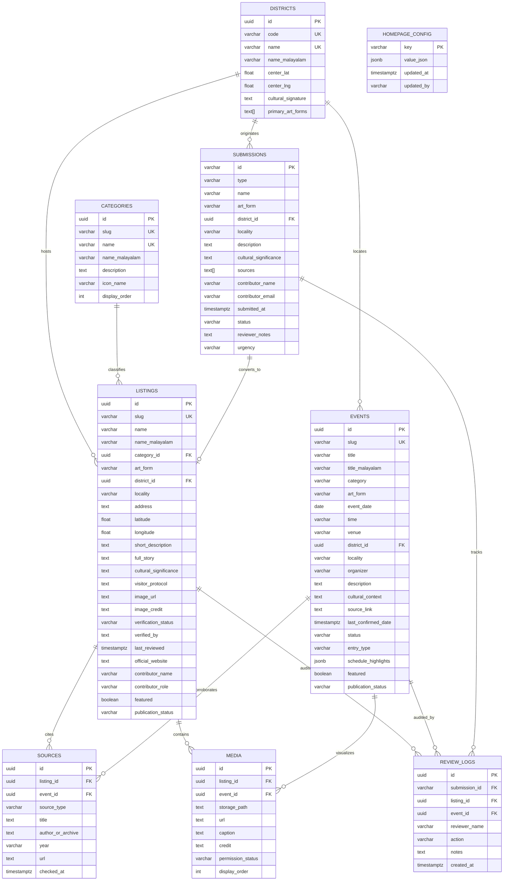

# Nattuvazhi — Database Schema & Architecture Design

**Target Supabase Project:** Nattuvazhi  
**Project Reference ID:** `ccmdiokhunvhwdmvsvop`  
**Supabase Endpoint:** `https://ccmdiokhunvhwdmvsvop.supabase.co` (from `.env.local`)  
**Design Status:** Architecture & Schema Design Finalized (Execution on Hold per Curatorial Directive)  
**Hackathon Track:** ART//CODE Hackathon Track 5: The Living Culture Map  

---

## 1. Project Verification & Safety Guardrail

> [!IMPORTANT]
> **Safety Directive Acknowledged:**  
> All future migrations, schema creations, and data seed operations are strictly scoped to the dedicated **Nattuvazhi** Supabase project (`ccmdiokhunvhwdmvsvop`). No migrations, table creations, or data imports will be executed against the remote database until explicitly directed by the user after MCP authentication.

---

## 2. Entity-Relationship Architecture

---

## 3. Relational Table Specifications

### 3.1 `districts`
Represents all 14 official administrative and cultural districts of Kerala. Reusable across listings, events, submissions, and the interactive map.

| Column | Type | Constraints | Description |
|---|---|---|---|
| `id` | `UUID` | `PRIMARY KEY DEFAULT uuid_generate_v4()` | Unique internal identifier |
| `code` | `VARCHAR(3)` | `NOT NULL UNIQUE` | Standard district code (e.g. `KSD`, `TSR`, `TVM`) |
| `name` | `VARCHAR(50)` | `NOT NULL UNIQUE` | English district name |
| `name_malayalam` | `VARCHAR(100)` | `NOT NULL` | Malayalam Unicode script name |
| `center_lat` | `DOUBLE PRECISION` | `NOT NULL` | Map centroid latitude |
| `center_lng` | `DOUBLE PRECISION` | `NOT NULL` | Map centroid longitude |
| `cultural_signature`| `TEXT` | `NOT NULL` | Curated editorial heritage description |
| `primary_art_forms` | `TEXT[]` | `NOT NULL DEFAULT '{}'` | Characteristic folk and classical art forms |
| `created_at` | `TIMESTAMPTZ` | `NOT NULL DEFAULT CURRENT_TIMESTAMP` | Creation timestamp |
| `updated_at` | `TIMESTAMPTZ` | `NOT NULL DEFAULT CURRENT_TIMESTAMP` | Last updated timestamp |

---

### 3.2 `categories`
Taxonomy of cultural dimensions and artistic traditions.

| Column | Type | Constraints | Description |
|---|---|---|---|
| `id` | `UUID` | `PRIMARY KEY DEFAULT uuid_generate_v4()` | Unique internal identifier |
| `slug` | `VARCHAR(50)` | `NOT NULL UNIQUE` | URL-safe identifier (e.g. `ritual-art`, `sacred-space`) |
| `name` | `VARCHAR(100)` | `NOT NULL UNIQUE` | English category name |
| `name_malayalam` | `VARCHAR(100)` | `NOT NULL` | Malayalam title |
| `description` | `TEXT` | `NULLABLE` | Anthropological definition |
| `icon_name` | `VARCHAR(50)` | `NULLABLE` | Lucide icon identifier |
| `display_order` | `INTEGER` | `NOT NULL DEFAULT 0` | UI sort priority |
| `created_at` | `TIMESTAMPTZ` | `NOT NULL DEFAULT CURRENT_TIMESTAMP` | Creation timestamp |

---

### 3.3 `listings`
The primary cultural inventory table for shrines, living practitioners, artisan guilds, and institutions.

| Column | Type | Constraints | Description |
|---|---|---|---|
| `id` | `UUID` | `PRIMARY KEY DEFAULT uuid_generate_v4()` | Listing unique ID |
| `slug` | `VARCHAR(150)` | `NOT NULL UNIQUE` | URL slug for `/culture/[slug]` |
| `name` | `VARCHAR(255)` | `NOT NULL` | Canonical English title |
| `name_malayalam` | `VARCHAR(255)` | `NOT NULL` | Native Malayalam title |
| `category_id` | `UUID` | `REFERENCES categories(id) ON DELETE SET NULL` | Category classification |
| `art_form` | `VARCHAR(150)` | `NOT NULL` | Specific art form or craft technique |
| `district_id` | `UUID` | `NOT NULL REFERENCES districts(id) ON DELETE RESTRICT` | Geographic district |
| `locality` | `VARCHAR(150)` | `NOT NULL` | Village, sacred enclave, or town |
| `address` | `TEXT` | `NOT NULL` | Full physical address descriptor |
| `latitude` | `DOUBLE PRECISION` | `NOT NULL` | Geographic coordinate |
| `longitude` | `DOUBLE PRECISION` | `NOT NULL` | Geographic coordinate |
| `short_description` | `TEXT` | `NOT NULL` | 1-2 sentence overview for directory cards |
| `full_story` | `TEXT` | `NOT NULL` | Multi-paragraph ethnographic narrative |
| `cultural_significance` | `TEXT` | `NOT NULL` | Historical context, subaltern lineage, and living meaning |
| `visitor_protocol` | `TEXT` | `NOT NULL` | Traditional decorum, photography restrictions, dress code |
| `image_url` | `TEXT` | `NOT NULL` | Primary card and hero image URL |
| `image_credit` | `TEXT` | `NOT NULL` | Photographer and archival attribution |
| `verification_status` | `VARCHAR(50)` | `CHECK IN ('Verified', 'Scholar Reviewed', 'Community Pending')` | Curatorial status badge |
| `verified_by` | `TEXT` | `NULLABLE` | Verifying folklore scholar or institution |
| `last_reviewed` | `TIMESTAMPTZ` | `NULLABLE` | Last audit check date |
| `official_website` | `TEXT` | `NULLABLE` | Verified external custodian URL |
| `contributor_name` | `VARCHAR(150)` | `NULLABLE` | Contributor credit |
| `contributor_role` | `VARCHAR(150)` | `NULLABLE` | Contributor designation |
| `contributor_submitted_at` | `TIMESTAMPTZ` | `NULLABLE` | Original accession submission date |
| `featured` | `BOOLEAN` | `NOT NULL DEFAULT false` | Shown on homepage curated grid |
| `display_order` | `INTEGER` | `NOT NULL DEFAULT 0` | Priority within directory |
| `tags` | `TEXT[]` | `NOT NULL DEFAULT '{}'` | Search keywords |
| `publication_status` | `VARCHAR(20)` | `CHECK IN ('published', 'draft', 'archived')` | Visibility flag |
| `created_at` | `TIMESTAMPTZ` | `NOT NULL DEFAULT CURRENT_TIMESTAMP` | Row creation timestamp |
| `updated_at` | `TIMESTAMPTZ` | `NOT NULL DEFAULT CURRENT_TIMESTAMP` | Row modification timestamp |

---

### 3.4 `events`
Cultural gatherings, temple poorams, Utsavams, and seasonal rituals.

| Column | Type | Constraints | Description |
|---|---|---|---|
| `id` | `UUID` | `PRIMARY KEY DEFAULT uuid_generate_v4()` | Event unique ID |
| `slug` | `VARCHAR(150)` | `NOT NULL UNIQUE` | URL slug for `/events/[slug]` |
| `title` | `VARCHAR(255)` | `NOT NULL` | English festival title |
| `title_malayalam` | `VARCHAR(255)` | `NOT NULL` | Malayalam script title |
| `category` | `VARCHAR(100)` | `NOT NULL` | Event category |
| `art_form` | `VARCHAR(150)` | `NOT NULL` | Core ritual or performing art |
| `event_date` | `DATE` | `NOT NULL` | ISO-8601 calendar date for queries |
| `formatted_date` | `VARCHAR(100)` | `NOT NULL` | Formatted date string for editorial presentation |
| `time` | `VARCHAR(100)` | `NOT NULL` | Daily schedule timeframe |
| `venue` | `VARCHAR(255)` | `NOT NULL` | Temple maidan or grounds |
| `district_id` | `UUID` | `NOT NULL REFERENCES districts(id)` | Host district |
| `locality` | `VARCHAR(150)` | `NOT NULL` | Specific locality |
| `address` | `TEXT` | `NULLABLE` | Full address |
| `organizer` | `VARCHAR(255)` | `NOT NULL` | Devaswom, committee, or guild |
| `description` | `TEXT` | `NOT NULL` | Event summary |
| `cultural_context` | `TEXT` | `NOT NULL` | Historical and ritual background |
| `source_link` | `TEXT` | `NOT NULL` | Verifiable official announcement URL |
| `last_confirmed_date` | `TIMESTAMPTZ` | `NOT NULL DEFAULT CURRENT_TIMESTAMP` | Verification timestamp |
| `status` | `VARCHAR(50)` | `CHECK IN ('Confirmed', 'Tentative', 'Annual Season', 'Cancelled', 'Postponed')` | Operational event status |
| `image_url` | `TEXT` | `NOT NULL` | Event cover photo |
| `entry_type` | `VARCHAR(50)` | `CHECK IN ('Free Entry', 'Pass Required', 'Ritual Offering')` | Visitor entry guideline |
| `schedule_highlights` | `JSONB` | `NOT NULL DEFAULT '[]'` | Array of `{ "time": string, "item": string }` |
| `featured` | `BOOLEAN` | `NOT NULL DEFAULT false` | Shown on homepage calendar preview |
| `publication_status` | `VARCHAR(20)` | `CHECK IN ('published', 'draft', 'archived')` | Visibility flag |
| `created_at` | `TIMESTAMPTZ` | `NOT NULL DEFAULT CURRENT_TIMESTAMP` | Row creation timestamp |
| `updated_at` | `TIMESTAMPTZ` | `NOT NULL DEFAULT CURRENT_TIMESTAMP` | Row update timestamp |

---

### 3.5 `sources`
Traceable scholarly citations, monographs, gazetteers, and official websites linked to listings and events.

| Column | Type | Constraints | Description |
|---|---|---|---|
| `id` | `UUID` | `PRIMARY KEY DEFAULT uuid_generate_v4()` | Citation ID |
| `listing_id` | `UUID` | `REFERENCES listings(id) ON DELETE CASCADE` | Associated listing |
| `event_id` | `UUID` | `REFERENCES events(id) ON DELETE CASCADE` | Associated event |
| `source_type` | `VARCHAR(50)` | `CHECK IN ('Academic Archive', 'Official Website', 'Monograph', 'Gazetteer', 'Fieldwork', 'Oral Lineage')` | Source classification |
| `title` | `TEXT` | `NOT NULL` | Document or article title |
| `author_or_archive` | `TEXT` | `NOT NULL` | Author, academic body, or archive |
| `year` | `VARCHAR(20)` | `NULLABLE` | Publication year |
| `url` | `TEXT` | `NULLABLE` | Direct external reference link |
| `checked_at` | `TIMESTAMPTZ` | `NOT NULL DEFAULT CURRENT_TIMESTAMP` | When curator checked source |

---

### 3.6 `media`
Curated photo gallery assets and archival documentation.

| Column | Type | Constraints | Description |
|---|---|---|---|
| `id` | `UUID` | `PRIMARY KEY DEFAULT uuid_generate_v4()` | Media ID |
| `listing_id` | `UUID` | `REFERENCES listings(id) ON DELETE CASCADE` | Parent listing |
| `event_id` | `UUID` | `REFERENCES events(id) ON DELETE CASCADE` | Parent event |
| `storage_path` | `TEXT` | `NULLABLE` | Supabase storage bucket relative path |
| `url` | `TEXT` | `NOT NULL` | Public access URL |
| `caption` | `TEXT` | `NOT NULL` | Photographic description |
| `credit` | `TEXT` | `NOT NULL` | Attribution |
| `permission_status` | `VARCHAR(50)` | `CHECK IN ('CC-BY-NC', 'Institution Approved', 'Community Provided', 'Public Domain')` | Rights status |
| `display_order` | `INTEGER` | `NOT NULL DEFAULT 0` | Gallery sequence order |

---

### 3.7 `submissions`
Community contributions submitted through `/contribute`.

| Column | Type | Constraints | Description |
|---|---|---|---|
| `id` | `VARCHAR(50)` | `PRIMARY KEY` | Accession identifier (e.g. `sub-101`) |
| `type` | `VARCHAR(30)` | `CHECK IN ('Place', 'Artist', 'Institution', 'Event', 'Correction')` | Contribution type |
| `name` | `VARCHAR(255)` | `NOT NULL` | Proposed title |
| `art_form` | `VARCHAR(150)` | `NOT NULL` | Associated tradition |
| `district_id` | `UUID` | `NOT NULL REFERENCES districts(id)` | Geographic district |
| `locality` | `VARCHAR(150)` | `NOT NULL` | Locality |
| `description` | `TEXT` | `NOT NULL` | Contributor narrative |
| `cultural_significance` | `TEXT` | `NOT NULL` | Why it should be documented |
| `sources` | `TEXT[]` | `NOT NULL DEFAULT '{}'` | Submitted references |
| `contributor_name` | `VARCHAR(150)` | `NOT NULL` | Contributor name |
| `contributor_email` | `VARCHAR(150)` | `NOT NULL` | Contributor contact |
| `submitted_at` | `TIMESTAMPTZ` | `NOT NULL DEFAULT CURRENT_TIMESTAMP` | Accession date |
| `status` | `VARCHAR(30)` | `CHECK IN ('Pending', 'Approved', 'Changes Requested', 'Rejected')` | Workflow state |
| `reviewer_notes` | `TEXT` | `NULLABLE` | Curator notes |
| `urgency` | `VARCHAR(20)` | `CHECK IN ('Low', 'Medium', 'High')` | Review urgency |
| `rights_confirmed` | `BOOLEAN` | `NOT NULL DEFAULT true` | Community consent affirmation |

---

### 3.8 `review_logs`
Immutable audit log tracking every curatorial decision, approval, date modification, and unpublishing action.

| Column | Type | Constraints | Description |
|---|---|---|---|
| `id` | `UUID` | `PRIMARY KEY DEFAULT uuid_generate_v4()` | Log ID |
| `submission_id` | `VARCHAR(50)` | `REFERENCES submissions(id) ON DELETE SET NULL` | Linked submission |
| `listing_id` | `UUID` | `REFERENCES listings(id) ON DELETE SET NULL` | Linked listing |
| `event_id` | `UUID` | `REFERENCES events(id) ON DELETE SET NULL` | Linked event |
| `reviewer_name` | `VARCHAR(150)` | `NOT NULL` | Curator identity |
| `reviewer_email` | `VARCHAR(150)` | `NOT NULL` | Curator contact |
| `action` | `VARCHAR(50)` | `NOT NULL` | Action code (e.g. `date_updated`, `approved`) |
| `notes` | `TEXT` | `NULLABLE` | Explanation of action taken |
| `created_at` | `TIMESTAMPTZ` | `NOT NULL DEFAULT CURRENT_TIMESTAMP` | Timestamp |

---

### 3.9 `homepage_config`
Key-value configuration store for editorial homepage copy and selected featured IDs.

| Column | Type | Constraints | Description |
|---|---|---|---|
| `key` | `VARCHAR(100)` | `PRIMARY KEY` | Configuration key (e.g. `hero_headline`) |
| `value_json` | `JSONB` | `NOT NULL` | Structured value |
| `updated_at` | `TIMESTAMPTZ` | `NOT NULL DEFAULT CURRENT_TIMESTAMP` | Timestamp |
| `updated_by` | `VARCHAR(150)` | `NULLABLE` | User who last updated the config |

---

## 4. Row Level Security (RLS) Policy Matrix

| Table | Public Read | Public Insert | Curator / Admin Full Access |
|---|---|---|---|
| `districts` | Allowed (all records) | Denied | Allowed |
| `categories` | Allowed (all records) | Denied | Allowed |
| `listings` | Allowed (`publication_status = 'published'`) | Denied | Allowed |
| `events` | Allowed (`publication_status = 'published'`) | Denied | Allowed |
| `sources` | Allowed (if parent published) | Denied | Allowed |
| `media` | Allowed (if parent published) | Denied | Allowed |
| `submissions` | Denied | Allowed (Community submissions) | Allowed |
| `review_logs` | Denied | Denied | Allowed (Curator Audit) |
| `homepage_config` | Allowed (Public text) | Denied | Allowed |

---

## 5. Storage Buckets & Policies

1. **`cultural-media`** (Public):
   - Stores photos for listings and festivals.
   - Public read access for web visitors.
   - Authenticated write access for curators only.
2. **`submission-attachments`** (Private):
   - Stores user-uploaded proof documents and raw community images.
   - Public insert only with 10MB size limit.
   - Read access restricted to authenticated curators.

---

## 6. Migration Status

The SQL migration script for this schema is prepared at:  
`supabase/migrations/20261108000000_nattuvazhi_core_schema.sql`

**Per user instructions, no SQL statements have been executed against `https://ccmdiokhunvhwdmvsvop.supabase.co`. The schema remains in design state pending user approval.**
