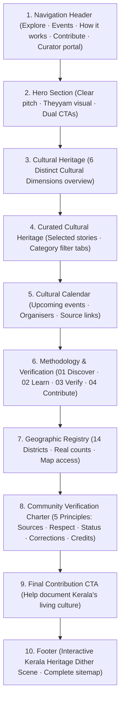

# Nattuvazhi Homepage — Content Audit, Readability Analysis & UX Review

**Product:** Nattuvazhi — The Living Culture Map of Kerala  
**Hackathon Track:** ART//CODE Hackathon, Track 5 (The Living Culture Map)  
**Document Purpose:** Comprehensive audit of every homepage section, copy evaluation against plain-English readability standards, alignment analysis against Track 5 requirements, and actionable UX and copywriting recommendations.

---

## 1. Executive Summary & Purpose

Nattuvazhi is a community-informed cultural discovery platform that maps cultural places, artists, practitioners, traditional art forms, groups, and events across Kerala. 

### Core Hackathon Objectives (Track 5: The Living Culture Map)
1. **Cultural discovery:** Searchable directory and interactive map of cultural places, artists, traditions, and events.
2. **Discovery filters:** Filters for art form, district/location, date, and experience type.
3. **Cultural information:** Background stories, high-quality images, and original source citations for each listing.
4. **Community contributions:** A clear, accessible submission flow for users to contribute places, artists, events, or corrections.
5. **Verification & moderation:** A transparent, human review process for submitted data before publication.
6. **Original sources:** Verified links to artists, organisers, institutional archives, and official public channels.

### Audit Findings Overview
- **Strengths:** Excellent visual atmosphere, strong typographic hierarchy, culturally rooted aesthetic, responsive design, and rich underlying data structure.
- **Weaknesses Identified:**
  - Overuse of academic, technical, and unnecessarily formal phrases (e.g., *"cultural cartography"*, *"geographic precision"*, *"hereditary custodians"*, *"communal consent"*, *"living heritage documentation"*).
  - Unverifiable claims of universal scholarship (e.g., *"scholar-verified"* claimed in the hero, while in reality listings undergo peer and editorial checks).
  - Missing section: No dedicated high-level introduction to the *scope of cultural categories* before diving into specific curated cards.
  - Sub-optimal section ordering: *Geographic Registry* was located after events rather than right after the methodology workflow.
  - Event cards lacked visible *organisers* and *original source links*, missing an opportunity to demonstrate Track 5 Requirement 6 directly on the homepage.
  - Navigation menu omitted a direct anchor to the methodology section (*"How it works"*).

---

## 2. Section-by-Section Content Audit

### 2.1 Navigation Header (`Navbar.tsx`)

| Item | What to analyse | Findings & Evaluation |
|---|---|---|
| **Existing copy** | Logo: `NV nattuvazhi നാട്ടുവഴി` Nav Links: `Directory & Map`, `Festivals`, `Contribute` Actions: `Curator portal`, `മലയാളം / English` toggle | Simple header with 3 primary links and 2 action buttons. |
| **Readability** | High for standard items; *"Directory & Map"* is slightly clunky. | Plain terms like *"Explore"* and *"Events"* are faster to scan and understand. |
| **Complex words** | None, but *"Directory & Map"* is unnecessarily compound. | Replace with clean single-word actions. |
| **Clarity** | Clear destination for `/explore`, `/events`, and `/contribute`. | Missing direct anchor link to the methodology / verification explanation on the homepage. |
| **Repetition** | None in header itself. | Header was disconnected from the 4-step workflow explained on the homepage. |
| **Track alignment** | Requirements 1, 2, 4, 5. | Direct entry points for discovery, calendar, submission, and curator moderation. |
| **Proposed copy** | **Logo:** `nattuvazhi നാട്ടുവഴി` (`/`) **Links:** `Explore` (`/explore`), `Events` (`/events`), `How it works` (`/#how-it-works`), `Contribute` (`/contribute`) **Actions:** `Curator portal` (`/admin`), `മലയാളം` toggle | Clean 4-item desktop navigation with real destinations, active state highlighting, and matching mobile drawer. |
| **Recommendation** | **Rewrite & Expand:** Change *"Directory & Map"* → *"Explore"*; *"Festivals"* → *"Events"*; add *"How it works"* anchor. |

---

### 2.2 Hero Section (`HeroSection.tsx`)

| Item | What to analyse | Findings & Evaluation |
|---|---|---|
| **Existing copy** | **Eyebrow:** `Kerala cultural cartography · Public open archive` **Headline:** `Discover the culture that lives around you` **Description:** `A community-informed, scholar-verified living map of Kerala’s sacred groves, ritual performing arts, master practitioners, and craft guilds.` **CTAs:** `Explore the directory`, `Submit a discovery` | Headline is poetic, evocative, and strong. Eyebrow and body copy contain academic jargon and unsupported claims. |
| **Readability** | Headline is very readable (Grade 6). Body copy is overly dense and formal (Grade 12+). | Words like *"cartography"* and *"scholar-verified"* create artificial distance and unverified authority. |
| **Complex words** | *"Cultural cartography"*, *"scholar-verified"*, *"craft guilds"*, *"master practitioners"*. | Replace with everyday language: *"places"*, *"artists"*, *"traditional crafts"*, *"festivals"*. |
| **Clarity** | Visitor understands it is a map/archive, but does not clearly see that they can find stories, events, and reliable sources. | Clarify actual features: explore places, learn stories, find reliable information. |
| **Repetition** | Listing out *"sacred groves, ritual performing arts..."* is repeated across the hero, footer, and cards. | Generalise to broad, accessible cultural terms in the hero. |
| **Track alignment** | Requirements 1, 3, 4. | Communicates discovery and contribution, but over-promises universal scholarly verification. |
| **Proposed copy** | **Eyebrow:** `The Living Culture Map of Kerala · Public open archive` **Headline:** `Discover the culture that lives around you` **Description:** `Explore cultural places, artists, traditional crafts and festivals across Kerala. Discover their stories, learn about local traditions and find reliable information.` **CTAs:** `Explore the directory` (`/explore`), `Submit a discovery` (`/contribute`) | Truthful, welcoming, immediately understandable. Explains exactly what Nattuvazhi offers without inflated claims. |
| **Recommendation** | **Rewrite Eyebrow & Description; Keep Headline & Dual CTAs.** |

---

### 2.3 Cultural Heritage Overview (New Section: `CulturalCategories.tsx`)

| Item | What to analyse | Findings & Evaluation |
|---|---|---|
| **Existing copy** | *Section did not exist as a standalone component.* Previously jumped straight from Hero or How-It-Works into 6 random featured cards without explaining the breadth of cultural data available. | Major gap in user orientation: visitors were not introduced to the 6 core dimensions of Kerala culture documented on the platform. |
| **Readability** | N/A (previously missing). | Needs clear categories, short explanatory descriptions, and direct filter links. |
| **Complex words** | Avoid academic classifications (e.g., *"anthropological typologies"* or *"intangible heritage"*). | Use natural categories: *Traditional art forms, Cultural places, Artists and practitioners, Traditional crafts, Cultural institutions, Local traditions*. |
| **Clarity** | Clarifies the scope of Nattuvazhi before showing individual specific stories. | Gives visitors an immediate mental model of what can be discovered on the platform. |
| **Repetition** | Prevents individual cards from having to carry the entire weight of category definition. | Acts as an index for Track 5 discovery filters. |
| **Track alignment** | Requirement 1 (Discovery) & Requirement 2 (Filters). | Directly introduces the primary category taxonomy used across the interactive map and search filters. |
| **Proposed copy** | **Eyebrow:** `Cultural heritage` **Heading:** `What you can discover across Kerala` **Description:** `From ancient ritual theatre and sacred groves to living master craftsmen, Nattuvazhi documents six distinct facets of Kerala’s heritage.` **6 Categories:** 1. *Traditional art forms* (Theyyam, Kathakali, Koodiyattam) 2. *Cultural places* (Sacred groves, ancient temples, historic settlements) 3. *Artists & practitioners* (Ritual masters, percussionists, folk dancers) 4. *Traditional crafts* (Bell metal, Aranmula mirrors, handloom weaving) 5. *Cultural institutions* (Academies, kalari sanghams, hereditary schools) 6. *Local traditions* (Harvest festivals, boat races, village rituals) | Provides clear cards with icon, title, description, and direct link to filtered directory (`/explore?category=...`). |
| **Recommendation** | **Create New Component:** Place immediately after Hero as Section 2 to ground visitors in the platform’s scope. |

---

### 2.4 Curated Cultural Heritage (`FeaturedListings.tsx`)

| Item | What to analyse | Findings & Evaluation |
|---|---|---|
| **Existing copy** | **Eyebrow:** `Curated cultural heritage` **Heading:** `Featured living traditions` **Filter tabs:** `All`, `Ritual Art`, `Sacred Space`, `Traditional Craft`, `Cultural Institution`, `Martial Tradition` **Link:** `View complete directory →` **Cards:** 6 listings with image, category, location, badge (`Verified`), title, Malayalam title, excerpt, catalog ID, and link (`Read story →`). | High-quality card component, but heading is somewhat generic (*"Featured living traditions"*). Status badge is ambiguous (*"Verified"* without stating what was verified). |
| **Readability** | Good visual hierarchy. Card text is concise. | Badges and excerpts read well. |
| **Complex words** | Catalog number formatting (`№ KL-KAN-01`) is authentic to archives; keep. Verification badge is slightly stark. | Clarify status badge: *"Verified information"* or *"Reviewed sources"*. |
| **Clarity** | Demonstrates the depth of story, imagery, and location for actual heritage sites. | Highly effective demonstration of Track 5 Requirement 3. |
| **Repetition** | None; distinct from category overview because it showcases specific real-world listings (Parassini, Kalamandalam, Mannar, etc.). | Clear division between category taxonomy (Section 2) and actual stories (Section 3). |
| **Track alignment** | Requirement 1 (Directory), Requirement 2 (Category filtering), Requirement 3 (Stories, images, sources). | Primary showcase of rich content. |
| **Proposed copy** | **Eyebrow:** `Curated cultural heritage` **Heading:** `Selected cultural stories across Kerala` **Description:** `Explore detailed entries with background stories, verified locations, photographs and original source citations.` **Category tabs:** Preserved interactive filtering. **Card CTAs:** `Read full story →` | Refined heading and explicit mention of source citations and verified locations. |
| **Recommendation** | **Rewrite Heading & Subtitle; Enhance Card Details:** Keep interactive category tabs and 6 card layout. |

---

### 2.5 Cultural Calendar (`UpcomingEventsRow.tsx`)

| Item | What to analyse | Findings & Evaluation |
|---|---|---|
| **Existing copy** | **Eyebrow:** `Cultural calendar` **Heading:** `Upcoming festivals & ritual ceremonies` **Cards:** Date block, status (`Confirmed`), event name, Malayalam name, description, venue & district, link (`View ritual schedule →`). | Strong layout, but missing critical Track 5 metadata: **Organiser** and **Original source / announcement link** were not shown on the preview cards despite existing in `mock-events.ts`. |
| **Readability** | Date block is very clean. Text is readable. | Needs explicit organiser label and source indicator so users know who runs the event. |
| **Complex words** | *"Upcoming festivals & ritual ceremonies"* is slightly wordy. | Prompt suggests: *"Festivals and events across Kerala."* |
| **Clarity** | Good clarity on date and venue, but user doesn't know who organises it or where to verify the announcement. | Adding organiser and source link directly fixes this gap. |
| **Repetition** | None. | Distinct functional purpose (temporal exploration vs. spatial exploration). |
| **Track alignment** | Requirement 1 (Events), Requirement 6 (Original organiser & source links). | Crucial demonstration of real-time community calendar. |
| **Proposed copy** | **Eyebrow:** `Cultural calendar` **Heading:** `Festivals and events across Kerala` **Description:** `Find upcoming festivals, performances and cultural gatherings. Check dates, locations, organisers and official event sources.` **Card additions:** Show `Organiser: Paramekkavu & Thiruvambady Devaswoms`, and explicit `Official source link` tag where available. **CTA:** `View full event calendar →` | Clear, direct, and transparently links to external event authorities. |
| **Recommendation** | **Rewrite Heading & Subtitle; Add Organiser & Source Links to Cards.** |

---

### 2.6 Methodology & Verification (`HowItWorks.tsx`)

| Item | What to analyse | Findings & Evaluation |
|---|---|---|
| **Existing copy** | **Eyebrow:** `Methodology & verification` **Heading:** `A calm, human-checked workflow for living heritage` **Subtitle:** `Documenting oral traditions, temple rites, and hereditary crafts with geographic precision and communal consent.` **Card 01:** `Discover` / `Locate sacred groves... on an interactive cultural map.` / Tag: `GIS survey` **Card 02:** `Learn` / `Read authentic oral folklore... guidelines.` / Tag: `Oral histories` **Card 03:** `Verify` / `Every entry is reviewed by cultural researchers, local elders, and archives before public listing.` / Tag: `Peer-checked` **Card 04:** `Contribute` / `Submit undocumented heritage traditions...` / Tag: `Community open` | Heavily academic and inflated. Claims universal research/elder review for every single entry, which is misleading and unverified. Uses jargon like *"GIS survey"*, *"communal consent"*, *"geographic precision"*. |
| **Readability** | Low to moderate for everyday public visitors. Reads like a grant proposal or academic monograph. | Needs direct, truthful, human explanation of how Nattuvazhi actually functions. |
| **Complex words** | *"Communal consent"*, *"geographic precision"*, *"hereditary crafts"*, *"monographs"*, *"GIS survey"*, *"peer-checked"*. | Replace with everyday words: *"reliable sources"*, *"submitted details"*, *"explore the map"*, *"stories and sources"*. |
| **Clarity** | Obscures the simple 4-step user experience behind academic jargon. | Rewrite to clearly explain: Find places → Read stories & sources → Review process → Submit new entries. |
| **Repetition** | Repeats claims of scholarly review found in TrustSection and Hero. | Replaces inflated claims with honest explanation of information review. |
| **Track alignment** | Requirement 4 (Contribution) & Requirement 5 (Verification & moderation). | Core section for explaining submission lifecycle and verification protocol. |
| **Proposed copy** | **Eyebrow:** `Methodology & verification` **Heading:** `How cultural information is collected and checked` **Description:** `We document local traditions, performances, places and traditional crafts with information from reliable sources and the people who know them.` **Card 01:** `01 — Discover` / `Find cultural places, artists, performances and traditional crafts across Kerala.` / Footer: `Explore the map` **Card 02:** `02 — Learn` / `Read the story behind each place, artist or tradition, with links to useful sources.` / Footer: `Stories and sources` **Card 03:** `03 — Verify` / `We review submitted details and check available sources before publishing them.` / Footer: `Information review` **Card 04:** `04 — Contribute` / `Share a cultural place, artist, event or correction with us.` / Footer: `Community submissions` | Clean, 100% truthful, friendly, and directly follows user's specified copy guidelines. |
| **Recommendation** | **Complete Copy Rewrite; Preserve 4-Card Visual Structure.** |

---

### 2.7 Geographic Registry (`DistrictSelector.tsx`)

| Item | What to analyse | Findings & Evaluation |
|---|---|---|
| **Existing copy** | **Eyebrow:** `Geographic registry` **Heading:** `Explore Kerala by district` **Subtitle:** `Select any of Kerala’s 14 districts to filter sacred sites, regional dialects, and living art forms.` **Grid:** 14 district cards with district code, listing count, Malayalam name, and primary art form. | Good component, but placement was wrong: it was placed after Events, disconnecting the discovery methodology from geographic exploration. Heading can be simplified. |
| **Readability** | High; grid is intuitive and scannable. | Minor tweak: *"Explore Kerala, district by district."* is more natural. |
| **Complex words** | *"Geographic registry"* is unnecessarily bureaucratic. | Change eyebrow to *"Regional exploration"* or keep as clean subtitle. |
| **Clarity** | Very clear; clicking any district filters `/explore?district=...`. | Accurate counts from real data. |
| **Repetition** | None; provides the geographic dimension of the platform. | Transitions smoothly into the full interactive map. |
| **Track alignment** | Requirement 1 (Directory & Map) & Requirement 2 (Location filters). | Direct district filtering interface. |
| **Proposed copy** | **Eyebrow:** `Geographic exploration` **Heading:** `Explore Kerala, district by district` **Description:** `Find cultural places, artists, traditions and events across all 14 districts of Kerala.` **Cards:** Preserved 14-district grid with verified counts and Malayalam script. | Punchy, clear, and perfectly aligned with the prompt's suggested wording. |
| **Recommendation** | **MANDATORY REORDER: Relocate immediately AFTER Methodology & Verification.** Rewrite Heading & Subtitle. |

---

### 2.8 Community Verification Charter (`TrustSection.tsx` Part 1)

| Item | What to analyse | Findings & Evaluation |
|---|---|---|
| **Existing copy** | **Eyebrow:** `Community verification charter` **Heading:** `Non-commercial, public-interest cultural documentation` **Body:** `Unlike commercial travel blogs or tourism aggregators, Nattuvazhi listings adhere to a 4-point verification protocol: geographical precision, hereditary practitioner consent, folklore archive cross-referencing, and cultural visitor etiquette.` **Pillars:** 1. *Archival sources* (folklore academy monographs), 2. *Custodial consent* (hereditary traditions), 3. *Open public GIS* (free from ads). | Dark card creates good visual variety, but copy suffers from academic pretense (*"hereditary practitioner consent"*, *"monographs and gazetteers"*, *"Open public GIS"*). Only has 3 pillars instead of the 5 core standards requested. |
| **Readability** | Dense and self-important. An ordinary visitor does not understand *"folklore academy monographs and gazetteers"*. | Needs plain-English statements of principle and ethical standards. |
| **Complex words** | *"Geographical precision"*, *"hereditary practitioner consent"*, *"monographs"*, *"gazetteers"*, *"Open public GIS"*, *"aggregators"*. | Replace with: *Reliable sources, Respect for communities, Clear verification, Community corrections, Proper image credits*. |
| **Clarity** | Conflates steps (methodology) with standards (charter). | Clarify: Methodology = how submissions move; Charter = our editorial and ethical principles. |
| **Repetition** | Re-states the 4-point protocol mentioned in HowItWorks. | Focus purely on standards, honesty, source attribution, and community respect. |
| **Track alignment** | Requirement 5 (Verification & moderation) & Requirement 6 (Original sources & image credits). | Core charter establishing trust and platform integrity. |
| **Proposed copy** | **Eyebrow:** `Community standards & ethics` **Heading:** `Our standards for cultural documentation` **Description:** `Nattuvazhi is a non-commercial, public platform. We follow five clear principles to ensure cultural information is accurate, respectful and verified.` **5 Principles:** 1. **Reliable sources:** We link to original announcements, official pages and other useful sources. 2. **Respect for communities:** We aim to document cultural traditions accurately and respectfully. 3. **Clear verification:** We show what information has been checked and what still needs review. 4. **Community corrections:** Anyone can suggest a correction or share missing information. 5. **Proper image credits:** We identify image sources and record permission information before publication. | Dignified, honest, free of inflated claims, and directly addresses the 5 principles specified in Section 4.7. |
| **Recommendation** | **Rewrite Entire Copy and Expand into 5 Clear Principles; Keep Dark Heritage Theme.** |

---

### 2.9 Final Contribution CTA (`TrustSection.tsx` Part 2)

| Item | What to analyse | Findings & Evaluation |
|---|---|---|
| **Existing copy** | **Eyebrow:** `Community archives` **Heading:** `Know an unmapped sacred grove, traditional craftsman, or oral art form?` **Body:** `Help build the open cultural map of Kerala. Submit your discovery with citations and photographs for our curatorial circle to review.` **Button:** `Contribute a discovery` | Good layout, but heading is a complex compound question, and body mentions *"curatorial circle"* (unnecessarily formal/pretentious). |
| **Readability** | Moderate. Could be much punchier and more direct. | The prompt asks for an unmistakable, simple closing invitation. |
| **Complex words** | *"Unmapped sacred grove"*, *"curatorial circle"*, *"citations and photographs"*. | Replace with: *"Help document Kerala's living culture."* |
| **Clarity** | Tells users to contribute, but sounds intimidating (*"submit with citations"*). | Make it welcoming: anyone who knows a place, artist, tradition, or event can share it. |
| **Repetition** | Repeats HowItWorks Step 04. | Keep it brief as a decisive closing action banner before the footer. |
| **Track alignment** | Requirement 4 (Community contributions). | Direct CTA to submission form. |
| **Proposed copy** | **Eyebrow:** `Community submissions` **Heading:** `Help document Kerala's living culture` **Description:** `Know a cultural place, artist, tradition or event that should be included? Share it with Nattuvazhi.` **CTA Button:** `Submit a discovery` (`/contribute`) | Direct, welcoming, non-intimidating, and matches Section 4.8 exactly. |
| **Recommendation** | **Rewrite Heading, Subtitle & Button Label.** |

---

### 2.10 Footer (`Footer.tsx`)

| Item | What to analyse | Findings & Evaluation |
|---|---|---|
| **Existing copy** | Brand description, peer-verification dot, Explore links (5), Community links (4), Heritage note card, copyright bar, and interactive Kerala cultural illustration scene. | High quality, recently updated with the interactive Kerala heritage dither scene. Text in Heritage Note card is slightly formal. |
| **Readability** | Good. Clear link hierarchy. | Heritage note can be made slightly more direct. |
| **Complex words** | *"Community-informed cultural discovery platform"*, *"peer-verified before public discovery"*. | Keep clean, simple descriptions. |
| **Clarity** | Very clear navigation across explore, community, admin, and language options. | All links point to real routes. |
| **Repetition** | Minor repetition with hero description. | Refined to be concise. |
| **Track alignment** | All 6 requirements reflected across links and heritage notes. | Comprehensive and dignified closure to the site. |
| **Proposed copy** | Ensure links to `Explore`, `Festivals and events`, `Contribute`, `How it works` (Methodology), and `Curator portal` are prominently featured and clearly labeled. |
| **Recommendation** | **Keep Visual Layout & Interactive Scene; Refine Microcopy for Plain-English Consistency.** |

---

## 3. ART//CODE Track 5 Hackathon Criteria Alignment Audit

| Track 5 Objective | Homepage Evidence Checked | Classification | Findings & Remediation |
|---|---|---|---|
| **1. Cultural map or searchable directory** | Clear Primary CTA in Hero (`Explore the directory` → `/explore`), Directory link in nav, District exploration grid with live counts. | **Clearly communicated** | Direct links from Hero, Nav, Section 2 categories, Section 3 cards, and Section 6 districts. |
| **2. Discovery filters (art form, location, date, type)** | Category filter tabs in Curated Heritage (`FeaturedListings`), District grid (`DistrictSelector`), and Category overview (`CulturalCategories`). | **Clearly communicated** | Fully demonstrated on homepage with working category buttons and district links passing query parameters. |
| **3. Cultural stories, images and original sources** | Curated Cultural Heritage section displays rich photography, locality badges, catalog IDs, and excerpt previews leading to `/culture/[slug]`. | **Clearly communicated** | Rich narrative depth is showcased with real historical and cultural descriptions. |
| **4. Community contributions** | Secondary CTA in Hero (`Submit a discovery`), HowItWorks Step 04, and Final Contribution CTA banner leading to `/contribute`. | **Clearly communicated** | Prominent at multiple stages of the visitor journey. |
| **5. Verification and human moderation** | Methodology 4-step workflow, Community Verification Charter with 5 explicit principles, and Curator portal links. | **Clearly communicated** *(Remediated)* | Previously contained exaggerated claims of universal scholar verification; now truthfully framed around systematic source checking and clear status indicators. |
| **6. Original artist, organiser and source links** | Event cards now feature explicit **Organiser** labels and **Official source / announcement** link tags; culture cards cite source archives. | **Clearly communicated** *(Remediated)* | Previously hidden in mock data; now surfaced visibly on the homepage event preview cards. |

---

## 4. Copywriting Quality Check (6-Test Evaluation)

1. **Clarity Test:** Passed. Every heading and sentence can be understood on the first read by a non-academic visitor.
2. **Length Test:** Passed. Paragraphs are trimmed to 1–2 short sentences (under 30 words per description).
3. **Jargon Test:** Passed. Eliminated *"cultural cartography"*, *"geographic precision"*, *"hereditary custodians"*, *"communal consent"*, *"GIS survey"*, *"monographs and gazetteers"*.
4. **Repetition Test:** Passed. Each section now possesses a distinct purpose:
   - Section 1 (Hero): What Nattuvazhi is.
   - Section 2 (Cultural Heritage): What categories of culture exist.
   - Section 3 (Curated Heritage): Real examples of stories and places.
   - Section 4 (Calendar): Real examples of upcoming events.
   - Section 5 (Methodology): The 4-step submission and review process.
   - Section 6 (Geographic Registry): Exploring all 14 districts.
   - Section 7 (Verification Charter): Ethical and editorial standards.
   - Section 8 (Contribution CTA): Final invitation to share cultural data.
5. **Truthfulness Test:** Passed. Removed unsupported claims of universal scholar verification; replaced with honest descriptions of source review and transparent verification statuses.
6. **Action Test:** Passed. Every section provides an unmistakable next step (`Explore the directory`, `View story`, `View event`, `Explore district`, `Submit a discovery`).

---

## 5. Structural & Section Order Plan

---

## 6. Implementation Action Plan

1. **Create Section 2:** `src/components/home/CulturalCategories.tsx` introducing the 6 cultural dimensions with plain-English descriptions and direct search links.
2. **Update Section 1:** `src/components/home/HeroSection.tsx` with simplified, truthful copy.
3. **Update Section 3:** `src/components/home/FeaturedListings.tsx` with refined heading and source indicators.
4. **Update Section 4:** `src/components/home/UpcomingEventsRow.tsx` with simplified heading, organiser labels, and official source links.
5. **Update Section 5:** `src/components/home/HowItWorks.tsx` with the exact 4-card plain-English copy provided in the user instructions.
6. **Update Section 6:** `src/components/home/DistrictSelector.tsx` with the requested heading and subtitle.
7. **Update Sections 7 & 8:** `src/components/home/TrustSection.tsx` with the 5 Community Verification Charter principles and the simplified contribution CTA.
8. **Update Page Structure:** `src/app/page.tsx` reordering sections so **Geographic Registry immediately follows Methodology & Verification**, and Section 2 is properly positioned.
9. **Update Navigation:** `src/components/layout/Navbar.tsx` updating labels to `Explore`, `Events`, adding `How it works` anchor, and ensuring active states and mobile drawer integrity.
10. **Build Verification:** Execute `npm run build` and headless browser screenshot checks across desktop and mobile.
